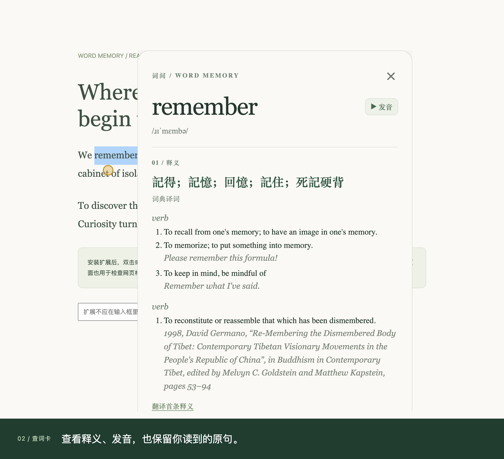

# 词间 · Word Memory

在英文网页上遇到生词，选中它，就能查意思、听发音、看看它的来历。把阅读中的原句和自己的联想一起收藏，再用每天的小复习慢慢记住。

适用于 Mac 上的 Chrome，免费使用，不需要注册账号。

**[下载 Chrome 安装包](https://github.com/JiayueShi/chrome-word-memory/raw/refs/heads/main/dist/word-memory-chrome.zip)** · **[观看用法演示](https://jiayueshi.github.io/chrome-word-memory/)**

## 它能帮你做什么

- **边读边查**：选中网页里的英文单词，直接查看释义、听英语发音。
- **从词源记忆**：了解单词的起源和构词，写下自己的联想。
- **留下阅读语境**：收藏单词时，一起保存当时读到的句子。
- **每天复习一点**：先回忆，再看答案，根据记忆情况安排下一次复习。

## 看一遍就会用

约 40 秒，带中文步骤字幕。点击封面播放，支持全屏观看。

## 安装

1. [下载安装包](https://github.com/JiayueShi/chrome-word-memory/raw/refs/heads/main/dist/word-memory-chrome.zip)，解压到一个你准备长期保留的位置。
2. 打开 Chrome，在地址栏输入 `chrome://extensions`，开启右上角的「开发者模式」。
3. 点击「加载已解压的扩展程序」，选择解压后 **word-memory-chrome 文件夹里面的 extension 文件夹**。
4. 点击 Chrome 工具栏里的拼图图标，找到「词间 · Word Memory」，点图钉固定。
5. 刷新已打开的英文网页，就可以开始划词了。

## 开始使用

### 1. 遇到生词，选中它

双击或拖动选中一个英文单词，点击浮现的「查词 ↗」。词卡里可以查看释义，点击「▶ 发音」听读音。按 Esc 或点击 × 关闭词卡，继续阅读。

也可以点击工具栏里的词间图标，直接输入单词查询。

### 2. 看看来历，写点联想

往下看「词源与构词」，了解单词的历史来历。词源原文是英语，可以点击「翻译词源开头」辅助阅读，也可以点击来源链接继续了解。

在「我的联想 / 记忆笔记」里，写下你对词源、句子或生活经验的联想，再点击「加入生词本」。网页里的原句会一起保存。

### 3. 有空时，复习几个词

点击词间图标，再点击「展开窗口」。在「我的生词本」里查看收藏，在「今日复习」里开始复习。

先试着想起单词的意思，再点击「显示答案」，选择「忘了」「模糊」或「记住了」。词间会安排下一次复习。复习时也可以听发音。

## 常见问题

**为什么选中单词后没有出现查词按钮？**

安装或更新后，先刷新网页。Chrome 设置页、Chrome 商店和内置 PDF 页面不能划词查词，可以点击词间图标手动输入。

**没有中文解释或词源怎么办？**

没有中文时，可以点击「翻译首条释义」，也可以填写自己的理解。部分单词暂时没有词源，复数或派生词可以试着查它的基础形式。自动翻译仅供参考，建议结合原句理解。

**发音没有声音怎么办？**

首次使用时稍等几秒，并确认系统音量已打开。如果提示缺少英语声音，在 Mac 的「系统设置 → 辅助功能 → 朗读内容」中添加英语语音，再重新打开 Chrome。

**如何更新，又保留我的生词？**

下载新版，用其中的 extension 文件夹覆盖原来的同名文件夹，保持位置不变。然后在 `chrome://extensions` 点击词间的重新加载按钮，再刷新网页。更新时保留原扩展。

**如何备份或换电脑？**

在「我的生词本」里点击「导出备份」。以后在同一页面点击「导入」，选择备份文件即可。更新或卸载前，建议先导出一份。

## 我的数据存在哪里？

生词、笔记和复习记录保存在当前 Chrome 浏览器里，不需要账号，不做云同步，也不上传你阅读的原句。

查新词需要联网；已经收藏的单词、复习和本机英语发音可以离线使用。查词会把查询词发送给公开词典，点击自动翻译时会发送相应的词典文本。

---

想了解更多：[数据来源](THIRD_PARTY.md) · [开发说明](DEVELOPMENT.md) · [验证记录](VERIFICATION.md)
