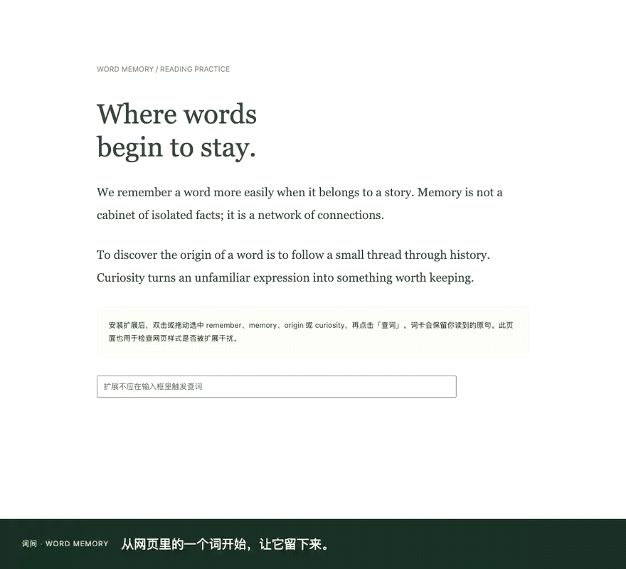

# 词间 · Word Memory

本机安装的 Chrome 扩展：网页划词查词、查看真实词源、留下阅读原句和记忆笔记，再通过间隔复习记住单词。

[下载 Chrome 安装包](dist/word-memory-chrome.zip) · [查看验证记录](VERIFICATION.md)

## 用法演示

约 40 秒，从网页划词开始：查看释义与词源 → 写下自己的联想 → 收藏原句 → 先回忆，再显示答案和安排复习。

[下载高清 MP4](https://github.com/JiayueShi/chrome-word-memory/raw/refs/heads/main/docs/word-memory-demo.mp4) · 无声演示，含中文步骤字幕。

演示中从网页切换到完整生词本：平时点击 Chrome 工具栏的扩展图标，再点击「展开窗口」。

## 安装（不需要运行服务器）

1. 下载并解压 word-memory-chrome.zip；也可以直接使用本项目的 extension 文件夹。
2. 在 Chrome 地址栏输入 chrome://extensions，开启右上角「开发者模式」。
3. 点击「加载已解压的扩展程序」，选择 **extension 文件夹**（这一层里面有 manifest.json）。
4. 在工具栏的拼图按钮中找到「词间 · Word Memory」，点击图钉固定。
5. 刷新已经打开的网页。在英文网页上双击或拖动选中一个单词，点击浮现的「查词 ↗」。

第一次安装时，Chrome 会说明扩展可访问网页和存储数据。网页访问用于显示查词入口及读取选词的附近原句；存储用于本地生词本。不上传网页全文，也不收集遥测。

## 怎么使用

- **网页查词**：选中一个英文单词，再点击「查词」。Escape、卡片外点击或 × 关闭词卡。
- **手动查词**：点击扩展图标，输入英文单词。点击「展开窗口」可在完整页面管理生词。
- **词源记忆**：词卡显示 Wiktionary 的英语历史词源、来源注明的词根/构词和关联词。关联词可以继续查。
- **中文解释**：优先显示词典的普通话译词（可能含繁体字、多种义项）。没有中文时可点击「翻译首条释义」，也可自行填写。
- **词源中文**：「翻译词源开头」翻译原文前 500 个字符，标为自动翻译，仅供参考。完整原文和来源链接保留。
- **我的联想**：记录你对词根、句子或生活经验的联想；收藏时保存原句、网页标题和网址。
- **生词本**：搜索单词、中文释义或笔记；点击单词查看和修改。重复保存不会重置复习进度。
- **复习**：先回忆意思，再显示答案。忘了：10 分钟后；模糊：1 天后；连续记住：1、3、7、14、30、60 天。
- **备份**：生词本里的「导出备份」保存 JSON，包含原句、笔记和复习记录。导入时合并新单词，已有单词保留当前记录。最多 5000 词，导入文件上限 8 MB。

## 本地与联网

生词、笔记、缓存和复习记录使用 chrome.storage.local，保存在当前 Chrome 配置中，不需要账号，不同步到服务器。查词会把查询词发给公开词典；只有点击自动翻译时，才把相应词典文本发给翻译接口。原网页句子不发给这些服务。

不联网时仍可使用已保存的生词本和缓存；新词查询需要联网。缓存最多 200 项、7 天内优先直接使用；超过期限会尝试更新，网络失败时保留旧结果。Chrome 本地存储也有容量上限，遇到保存失败请导出备份并清理部分词条。

卸载扩展、删除 Chrome 配置或清除扩展存储可能删除记录，请定期导出备份。更新版本时建议保留同一 extension 文件夹的路径，再在 chrome://extensions 点击刷新；先备份最稳妥。

## 范围与数据来源

支持普通 HTTP/HTTPS 网页的顶层文档。Chrome 内部页面、Chrome 商店、内置 PDF、跨域 iframe 或不能选中文字的区域，请改用扩展图标手动输入。默认不启用本地 file 页面权限，也不做截图 OCR。输入框、密码框和可编辑区域不会自动取词。

释义来自 Free Dictionary API，词源和中文译词来自英语 Wiktionary 及 Kaikki 的 Wiktionary 数据镜像；自动翻译来自 MyMemory。这些公开服务可能有访问限制、配额或临时故障；任一来源失败，不会阻止其他来源显示结果。词条覆盖不是全量离线词典，派生词或复数可能没有独立词源，可以查其基础词形。

词源使用公开词条的文本解析，保留英语段、多个词源分支和来源链接；词根/构词按词源分支编号标明，避免混淆同形词的不同起源；复杂模板不一定完整展示。星号标记的原始语词根是语言学重建形式，不是今天的英语词。历史词源、来源记录的构词和用户自己的记忆联想是不同信息；扩展不根据拼写编造词根。源条目可能有多种义项，结合阅读语境判断。

详见 THIRD_PARTY.md。无付费密钥、生成式 AI、广告和遥测。

## 开发与验证

无需 npm install。测试使用 Node 内置测试框架：

    npm test
    npm run package

浏览器测试需 Playwright 和独立 Chromium/Chrome for Testing，可设置环境变量（默认用捕获的真实 API 响应验证交互；增加 WORD_MEMORY_LIVE=1 可验证首个词的真实联网查询）：

    PLAYWRIGHT_MODULE=/绝对路径/playwright-core/index.mjs \
    WORD_MEMORY_BROWSER=/绝对路径/Chrome-for-Testing可执行文件 \
    node scripts/browser-smoke.mjs

示例阅读页位于 demo/reading.html。若要验证网页划词，可在本项目目录运行 python3 -m http.server 8769 --bind 127.0.0.1，然后访问 http://127.0.0.1:8769/demo/reading.html。平时使用扩展无需此服务器。

录制用法演示使用 scripts/record-demo.mjs（与浏览器测试相同的两个环境变量，另需 Playwright 的 FFmpeg）。脚本在独立临时 Chrome 配置里操作真实扩展，用捕获的词典响应避免网络等待；字幕和光标提示仅用于录制。可设置 WORD_MEMORY_RECORDING 指定原始 WebM 和检查截图的输出目录，不接触日常 Chrome 的生词记录。
